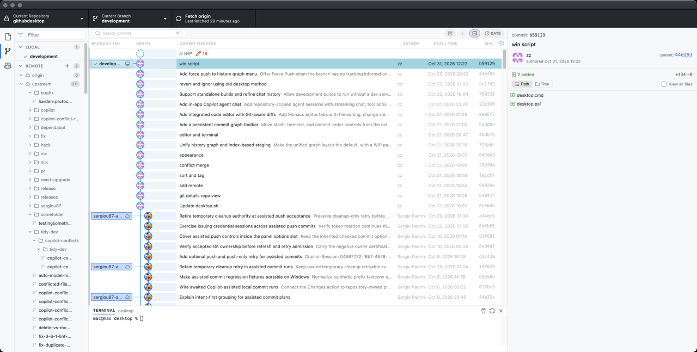
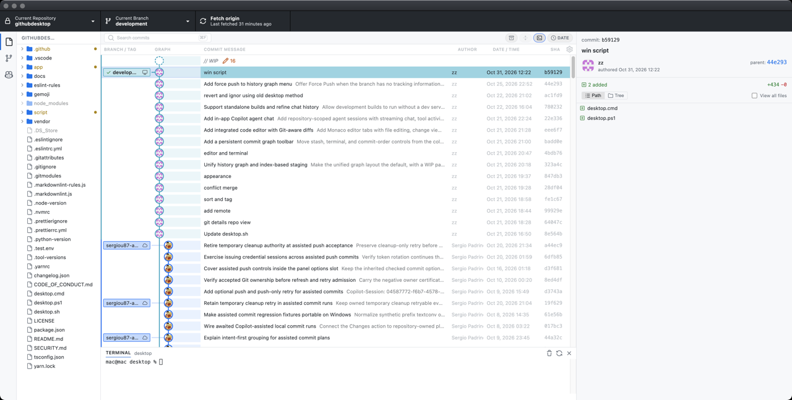
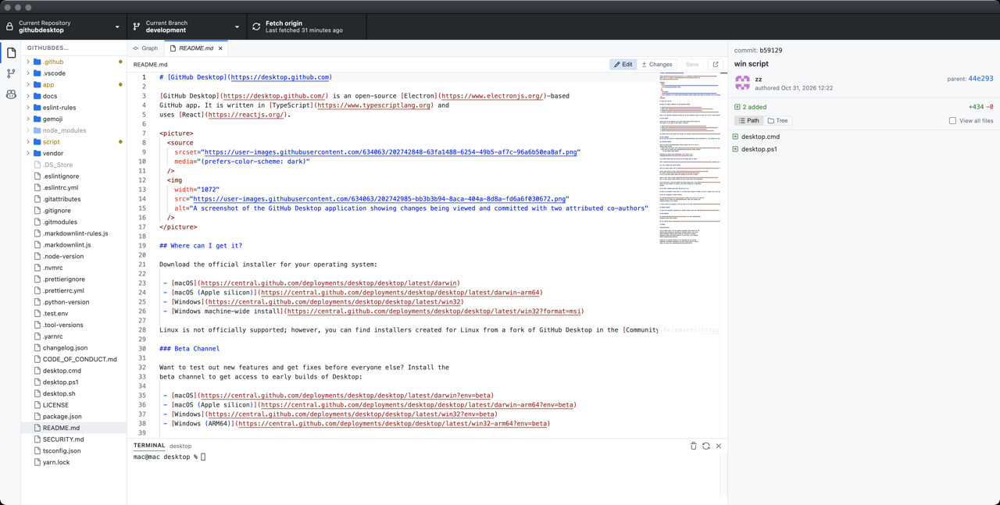
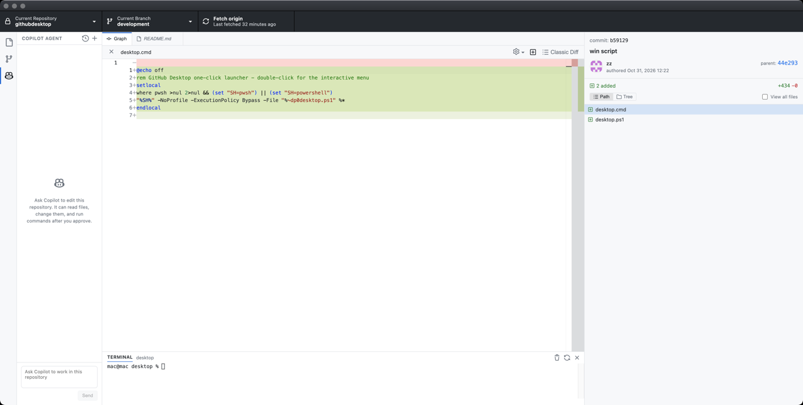
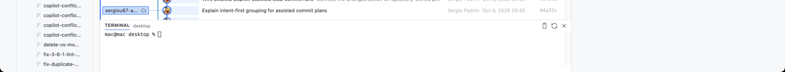
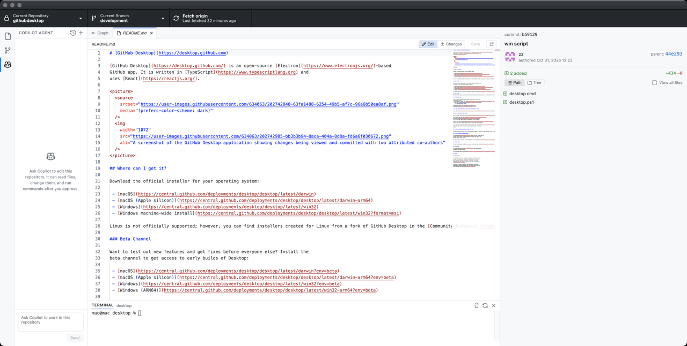

# GitHub Desktop

[中文](README.md) | **English**

This is a fork of [desktop/desktop](https://github.com/desktop/desktop). Day-to-day editing stays in one window: the commit graph, file tree, editor, terminal, and Copilot agent.

## Download

macOS and Windows installers are on [Releases](https://github.com/coolzoom/githubdesktop/releases). A push to `development` builds them and publishes a new version.

- macOS: download `GitHub Desktop-arm64.zip` or `GitHub Desktop-x64.zip`, unzip it, and move GitHub Desktop.app into Applications.
- Windows: run `GitHubDesktopSetup-x64.exe` or `GitHubDesktopSetup-arm64.exe`.

Dev builds and installed builds both check this repository's latest Release at startup, then again every 4 hours. A newer release shows a banner with a download for the current platform. A build of the same commit as that Release does not prompt.

The installers are not signed with Apple or Azure certificates. The first time you open the macOS app, right-click it in Finder and choose Open.

## Commit graph

History opens on the commit graph. Branches and tags are drawn on the graph, and uncommitted work appears as `// WIP`. Search commits, sort by date or topology, and check out or tag from the context menu. Force Push is available when the branch has no upstream or is ahead of the remote.

## File tree

The activity bar switches between the file tree, branches / tags / stashes, and Copilot. Changed files have a dot. Clicking a file opens it in the editor.

## Editor

The editor is Monaco and can keep several files open. Edit turns on editing, and Save writes the file back to the working tree. The gutter on the right shows how the file differs from the current revision.

## Diff

Click a file in a commit to see a syntax-highlighted diff. The classic diff is still available.

## Terminal

A terminal for the current repository docks under the graph and the editor. The shortcut is Ctrl+`. Clear the screen, restart the shell, or hide the terminal.

## Copilot

The Copilot agent can read this repository, edit files, and run commands. Edits and commands ask for approval first. Chats can be created, switched, and deleted.

## Build from source

Setup is documented in [`docs/contributing/setup.md`](docs/contributing/setup.md).

## License

**[MIT](LICENSE)**

The MIT license does not grant rights to GitHub's trademarks. GitHub reserves all trademark and copyright rights in its marks, including the Invertocat designs whose file names include "logo" in [logos](app/static/logos). Follow the GitHub [logo guidelines](https://github.com/logos) when using them.
