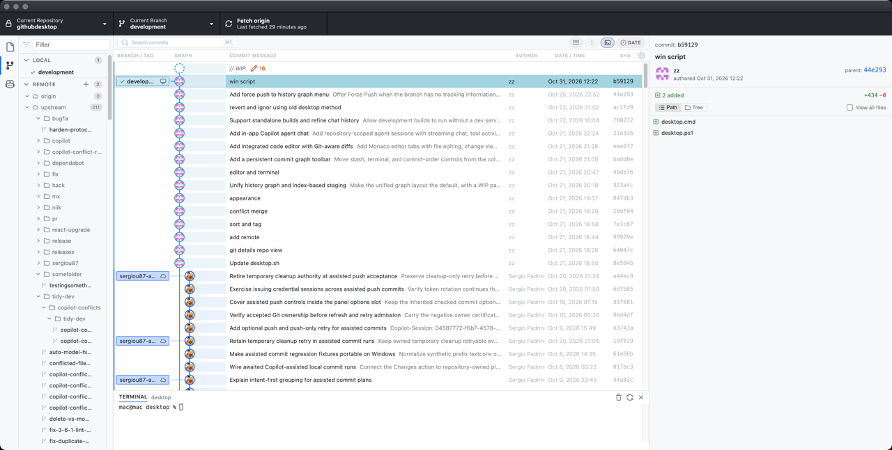
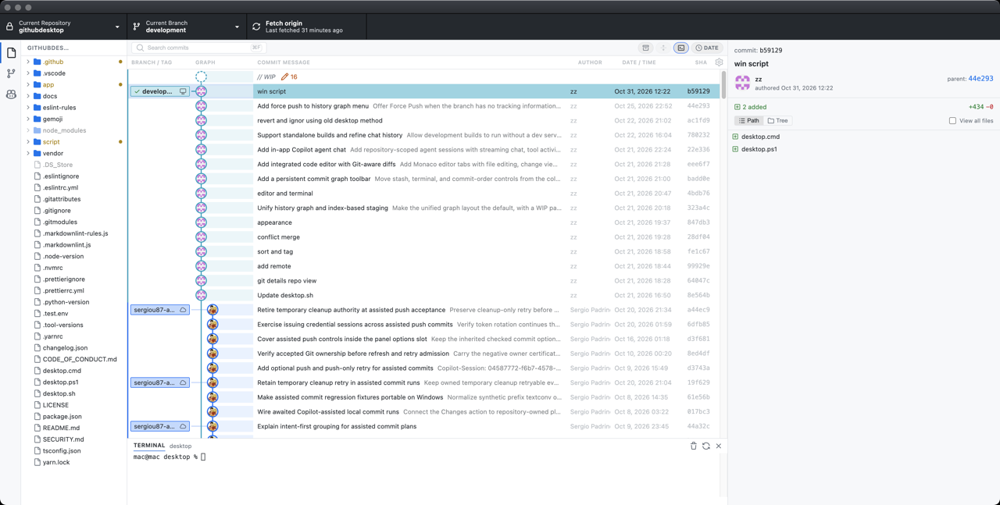
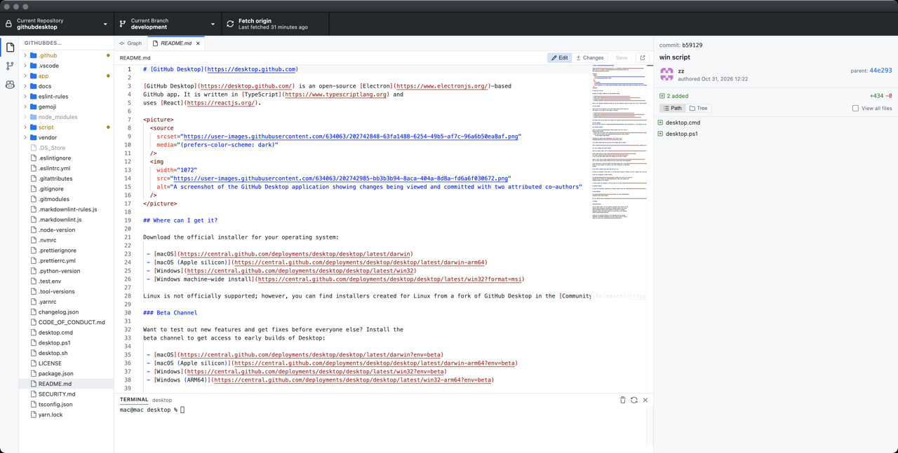
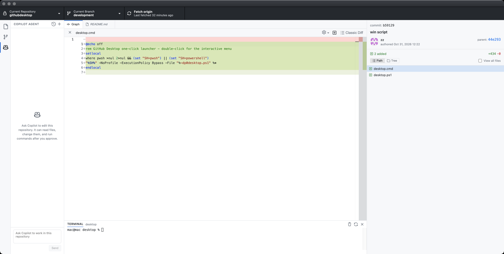
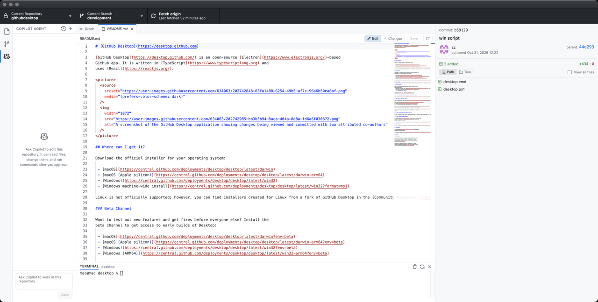

# GitHub Desktop

**中文** | [English](README.en.md)

这是 [desktop/desktop](https://github.com/desktop/desktop) 的分支。日常改代码可以留在同一个窗口里：提交图、文件树、编辑器、终端和 Copilot 代理。

## 下载

macOS 和 Windows 安装包在 [Releases](https://github.com/coolzoom/githubdesktop/releases)。推送到 `development` 后，GitHub Actions 会编译并发布新版本。

- macOS：下载 `GitHub Desktop-arm64.zip` 或 `GitHub Desktop-x64.zip`，解压后把 GitHub Desktop.app 放进“应用程序”。
- Windows：运行 `GitHubDesktopSetup-x64.exe` 或 `GitHubDesktopSetup-arm64.exe`。

开发版和安装版启动时都会检查这个仓库的最新 Release，之后每 4 小时再查一次。有更新时窗口顶部会出现提示，可下载对应平台的安装包。当前代码如果就是该 Release 的同一次提交，则不会提示。

这些安装包没有 Apple 或 Azure 签名。macOS 第一次打开时，在 Finder 里对应用点右键，选择“打开”。

## 提交图

History 默认是提交图。分支和标签画在图上，正在修改的文件显示为 `// WIP`。可以搜索提交、按日期或拓扑排序，并从右键菜单检出、打标签。分支没有上游或领先远程时，菜单里有 Force Push。

## 文件树

左侧活动栏在文件树、分支 / 标签 / 储藏、Copilot 之间切换。改过的文件旁边有圆点。点一个文件会在编辑器里打开。

## 编辑器

编辑器使用 Monaco，可以同时打开多个文件。Edit 打开编辑，Save 写回工作区。右侧是这个文件相对当前版本的改动。

## 差异

在一次提交里点文件，会看到带语法高亮的差异。也可以切回经典差异。

## 终端

提交图和编辑器下面可以打开当前仓库的终端，快捷键是 Ctrl+`。可以清屏、重启 shell，或把终端收起来。

## Copilot

Copilot Agent 可以读这个仓库、改文件、运行命令。改动和命令会先征求同意。聊天可以新建、切换和删除。

## 从源码构建

环境准备见 [`docs/contributing/setup.md`](docs/contributing/setup.md)。

## 许可证

**[MIT](LICENSE)**

MIT 许可不包括 GitHub 的商标。GitHub 保留其商标和标识的全部权利，包括 [logos](app/static/logos) 目录里带 “logo” 的 Invertocat 图案。使用这些标识时请遵守 GitHub 的 [logo guidelines](https://github.com/logos)。
